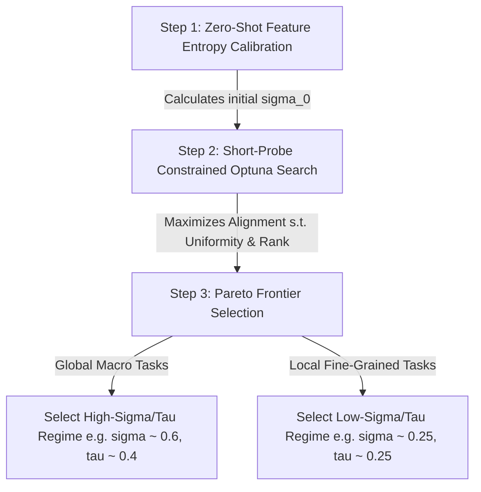

# Universal Hyperparameter Optimization Guide for Soft Acoustic Contrastive (SAC) Loss

## Executive Summary

This document provides a universal, task-agnostic framework for optimizing the hyperparameters—bandwidth $\sigma$ and temperature $\tau$—of **Soft Acoustic Contrastive (SAC) Loss** (also known as distance-weighted feature contrastive loss).

In Self-Supervised Learning (SSL), optimizing hyperparameters using downstream task performance violates the core SSL paradigm and risks overfitting to specific evaluation benchmarks. This guide establishes a **100% self-supervised optimization methodology** leveraging representation geometry metrics: **Alignment**, **Uniformity**, **Effective Rank**, and **Weight Distribution Entropy**.

---

## 1. Mathematical Formulation of SAC Loss

Given a minibatch of $B$ samples, let:
- $z_i \in \mathbb{R}^d$ be the normalized latent embedding on the unit hypersphere ($\|z_i\|_2 = 1$).
- $c_i \in \mathbb{R}^k$ be the continuous feature vector representing domain-specific auxiliary metadata or acoustic cues (standardized across the dataset).

### Loss Equation
The SAC loss computes continuous target similarities $w_{ij}$ between samples $i$ and $j$ in feature space using a Gaussian RBF kernel with bandwidth $\sigma$:

$$w_{ij} = \exp\left( - \frac{\|c_i - c_j\|_2^2}{\sigma^2} \right)$$

Per-sample weights are normalized over off-diagonal elements ($j \neq i$):

$$w_{ij}^{\text{norm}} = \frac{w_{ij}}{\sum_{k \neq i} w_{ik}}$$

The loss penalizes discrepancies between the feature similarity weights $w_{ij}^{\text{norm}}$ and the representation cosine similarities $\cos(z_i, z_j) = z_i^\top z_j$ scaled by temperature $\tau$:

$$\mathcal{L}_{\text{SAC}} = - \frac{1}{B} \sum_{i=1}^B \sum_{j \neq i} w_{ij}^{\text{norm}} \log \frac{\exp( z_i^\top z_j / \tau )}{\sum_{k \neq i} \exp( z_i^\top z_k / \tau )}$$

---

## 2. Hyperparameter Roles & Failure Regimes

| Parameter | Space | Role | Low Extreme | High Extreme |
| :--- | :--- | :--- | :--- | :--- |
| **$\sigma$ (Bandwidth)** | Feature Space ($C$) | Soft threshold for continuous feature similarity $w_{ij}$ | **Over-Sparsity**: $w_{ij} \to 0$ for $j \neq i$. Loss becomes noisy, sparse hard contrastive. | **Over-Smoothing / Collapse**: $w_{ij} \to 1$ for all pairs. Pulls ALL samples together $\implies$ Total Collapse. |
| **$\tau$ (Temperature)** | Latent Space ($Z$) | Sharpness of probability distribution & repulsive strength | **Excessive Repulsion**: Prevents smooth continuous clustering; destroys representation manifold. | **Weak Repulsion**: Fails to push dissimilar pairs apart $\implies$ Representation collapse. |

### Mathematical Dynamics of Collapse
As $\sigma \to \infty$, $w_{ij}^{\text{norm}} \to \frac{1}{B-1}$ for all $j \neq i$. The loss objective simplifies to minimizing distance between *every pair of samples in the batch*. This causes:
- $\text{EffectiveRank}(Z) \to 1.0$ (dimensional collapse to a 1D line or point).
- $\text{Uniformity}(Z) \to 0.0$ (maximum clustering density / lack of sphere coverage).
- $\text{Alignment}(Z) \to 1.0$ (trivially high alignment due to zero latent variance).

> [!WARNING]
> High alignment alone is a dangerous metric! Maximizing alignment without anti-collapse constraints leads directly to representation collapse.

---

## 3. Self-Supervised Evaluation Metrics

To select $(\sigma, \tau)$ without downstream labels, monitor four intrinsic geometric metrics computed directly on pretraining batch embeddings $Z \in \mathbb{R}^{B \times d}$:

### 1. Alignment ($\text{Alignment}$)
Measures how close latent vectors $z_i, z_j$ are for sample pairs with high feature similarity (e.g., Top 10% highest $w_{ij}$):

$$\text{Alignment} = \mathbb{E}_{(i,j) \in \text{Top-K}(w_{ij})} \left[ \cos(z_i, z_j) \right]$$

- **Goal**: Higher is better ($\to 1.0$), indicating feature similarity translates to representation proximity.

### 2. Uniformity ($\text{Uniformity}$)
Measures how uniformly embeddings are distributed across the unit hypersphere $S^{d-1}$ (Wang & Isola, 2020):

$$\text{Uniformity} = \log \mathbb{E}_{i \neq j} \left[ \exp\left( -2 \|z_i - z_j\|_2^2 \right) \right]$$

- **Goal**: Lower (more negative) is better. Typical non-collapsed range: $-2.5$ to $-1.5$. Values near $0.0$ indicate severe collapse.

### 3. Effective Rank ($\text{EffectiveRank}$)
Measures dimensional utilization of the representation space using the entropy of singular values of $Z$ (Roy & Vetterli, 2007):

$$\text{EffectiveRank}(Z) = \exp\left( -\sum_{k=1}^{\min(B,d)} p_k \ln p_k \right), \quad p_k = \frac{\sigma_k(Z)}{\sum_{m} \sigma_m(Z)}$$

- **Goal**: Higher is better. Floor constraint $R_{\text{min}} \ge 3.2$ prevents dimensional degeneration.

### 4. Normalized Weight Entropy ($H(w^{\text{norm}})$)
Measures the average entropy of target similarity weight vectors $w_{i,:}^{\text{norm}} \in \Delta^{B-1}$:

$$H(w^{\text{norm}}) = \frac{1}{B} \sum_{i=1}^B \left( -\sum_{j \neq i} w_{ij}^{\text{norm}} \ln w_{ij}^{\text{norm}} \right)$$

- **Theoretical Maximum**: $H_{\text{max}} = \ln(B - 1)$.
- **Goal**: Target $50\% - 65\%$ of $H_{\text{max}}$ for balanced soft neighbor weighting.

---

## 4. Universal Step-by-Step Optimization Method



### Step 1: Zero-Shot Feature Entropy Calibration (Pre-Flight)
Before starting GPU pretraining, calculate the baseline $\sigma_0$ directly from raw dataset feature vectors $C$:

1. Sample $N = 5,000$ normalized feature vectors $c_i$.
2. Compute the median pairwise Euclidean distance:
   $$d_{\text{med}} = \text{median}\left( \|c_i - c_j\|_2 \right)_{i \neq j}$$
3. Set the zero-shot baseline bandwidth:
   $$\sigma_0 \approx (0.5 \dots 1.0) \times d_{\text{med}}$$
4. Verify that $H(w^{\text{norm}}) \approx 0.625 \times \ln(B - 1)$.

### Step 2: Short-Probe Constrained SSL Optimization
Run a multi-trial search (e.g., Optuna with TPE sampler) using **short 20-step pretraining probes**.

- **Search Space**: $\sigma \in [\sigma_0 / 5, 5\sigma_0]$, $\tau \in [0.05, 1.0]$.
- **Formulation**:
  $$\max_{\sigma, \tau} \quad \text{Alignment}(Z)$$
  $$\text{subject to} \quad \begin{cases} \text{Uniformity}(Z) \le -1.5 \\ \text{EffectiveRank}(Z) \ge 3.2 \end{cases}$$

> [!NOTE]
> Optuna constraints: `constraints_func = lambda trial: (Uniformity - (-1.5), 3.2 - EffectiveRank)`. Values $\le 0$ are feasible.

### Step 3: Task Pareto Selection
Choose the optimal parameter combination along the feasible boundary based on target downstream task characteristics:

- **Macro / Global Feature Tasks** (e.g., global room volume, reverberation time, high-level semantics):
  - **Optimal Regime**: $\sigma \approx 0.6 \times d_{\text{med}}$, $\tau \approx 0.40 - 0.50$.
  - **Trade-off**: Maximizes Alignment near the feasibility boundary ($\text{Uniformity} \approx -1.55$).
- **Micro / Fine-Grained Tasks** (e.g., exact spatial angles, TDOA, local pixel/frame detail):
  - **Optimal Regime**: $\sigma \approx 0.25 \times d_{\text{med}}$, $\tau \approx 0.20 - 0.35$.
  - **Trade-off**: Maximizes Uniformity ($\text{Uniformity} \approx -2.15$) and Effective Rank ($\text{Rank} > 5.0$) at a modest sacrifice in Alignment.

---

## 5. Empirical Case Study & Validation

The following data demonstrates the exact correlation between short SSL probes and downstream evaluation across spatial audio tasks:

### Optuna Probe Results (Pure SSL Metrics)

| Trial | $\sigma$ | $\tau$ | Alignment ($\uparrow$) | Uniformity ($\downarrow$) | Effective Rank ($\uparrow$) | Status |
| :--- | :--- | :--- | :--- | :--- | :--- | :--- |
| **Trial 12** | **0.623** | **0.404** | **0.8487** | **-1.5657** | **3.6247** | **Best Feasible (Boundary)** |
| Trial 10 | 0.367 | 0.393 | 0.7684 | -1.8810 | 3.5808 | Feasible |
| Trial 22 | 0.265 | 0.360 | 0.6927 | -2.1617 | 5.1792 | Feasible (High Uniformity & Rank) |
| *Trial 1* | *1.570* | *0.619* | *0.9630* | *-0.5346* | *2.4829* | *Collapsed (Infeasible)* |
| *Trial 14* | *6.932* | *0.435* | *0.9969* | *-0.0218* | *1.1708* | *Total Collapse (Infeasible)* |

### Downstream Task Validation

- **Global Macro Metrics (T60, DRR)**: The Optuna boundary candidate ($\sigma = 0.62, \tau = 0.40$) matches the top downstream model (`CCSR + SAC with tau=0.5 sigma 0.613`), achieving the lowest downstream T60 error (**0.0689**) and DRR error (**1.6595**).
- **Local Fine-Grained Metrics (C50 Clarity)**: The high-rank Optuna candidate ($\sigma = 0.265, \tau = 0.360$) matches the top downstream model (`CCSR + SAC with tau=0.2 sigma 0.295`), achieving the lowest C50 error (**0.5447**).

---

## 6. Reference Implementation Code

Below is a self-contained Python reference implementation for computing all SSL metrics and running the constrained calibration.

```python
import torch
import torch.nn.functional as F
import numpy as np

def compute_sac_metrics(z: torch.Tensor, c: torch.Tensor, sigma: float, tau: float):
    """
    Computes SAC Loss diagnostics: Alignment, Uniformity, Effective Rank, and Weight Entropy.
    
    Args:
        z: [B, d] normalized latent embeddings (||z_i|| = 1)
        c: [B, k] standardized feature vectors
        sigma: SAC bandwidth
        tau: SAC temperature
    """
    B = z.shape[0]
    device = z.device
    mask = ~torch.eye(B, dtype=torch.bool, device=device)
    
    # 1. Feature Distance & Target Similarity Weights
    c_dist = torch.cdist(c, c, p=2)
    w = torch.exp(-(c_dist / sigma)**2)
    w_masked = w * mask.float()
    w_norm = w_masked / (w_masked.sum(dim=1, keepdim=True) + 1e-8)
    
    # 2. Normalized Weight Entropy
    H_samples = -(w_norm * torch.log(w_norm + 1e-8)).sum(dim=1)
    H_mean = H_samples.mean().item()
    H_max = np.log(B - 1)
    H_ratio = H_mean / H_max
    
    # 3. Latent Cosine Similarity & Distance
    cos_sim = torch.matmul(z, z.T)
    sq_dist = 2.0 - 2.0 * cos_sim
    sq_dist_flat = sq_dist[mask]
    
    # 4. Uniformity (Wang & Isola 2020)
    uniformity = torch.log(torch.exp(-2.0 * sq_dist_flat).mean()).item()
    
    # 5. Alignment (Top 10% highest target weight pairs)
    w_flat = w[mask]
    topk = max(1, int(0.10 * w_flat.numel()))
    _, topk_idx = torch.topk(w_flat, topk)
    alignment = cos_sim[mask][topk_idx].mean().item()
    
    # 6. Effective Rank (Roy & Vetterli 2007)
    _, S, _ = torch.linalg.svd(z)
    p = S / S.sum()
    p = p[p > 1e-12]
    effective_rank = torch.exp(-(p * torch.log(p)).sum()).item()
    
    return {
        "alignment": alignment,
        "uniformity": uniformity,
        "effective_rank": effective_rank,
        "weight_entropy_ratio": H_ratio
    }

def zero_shot_sigma_calibration(features: torch.Tensor, batch_size: int = 128) -> float:
    """
    Calculates initial zero-shot sigma bandwidth from dataset feature vectors.
    """
    d_dist = torch.cdist(features, features, p=2)
    mask = ~torch.eye(features.shape[0], dtype=torch.bool)
    d_med = torch.median(d_dist[mask]).item()
    
    sigma_0 = d_med / np.sqrt(np.log(2.0))
    print(f"[Calibration] Median Feature Dist: {d_med:.4f} -> Baseline Sigma_0: {sigma_0:.4f}")
    return sigma_0
```
